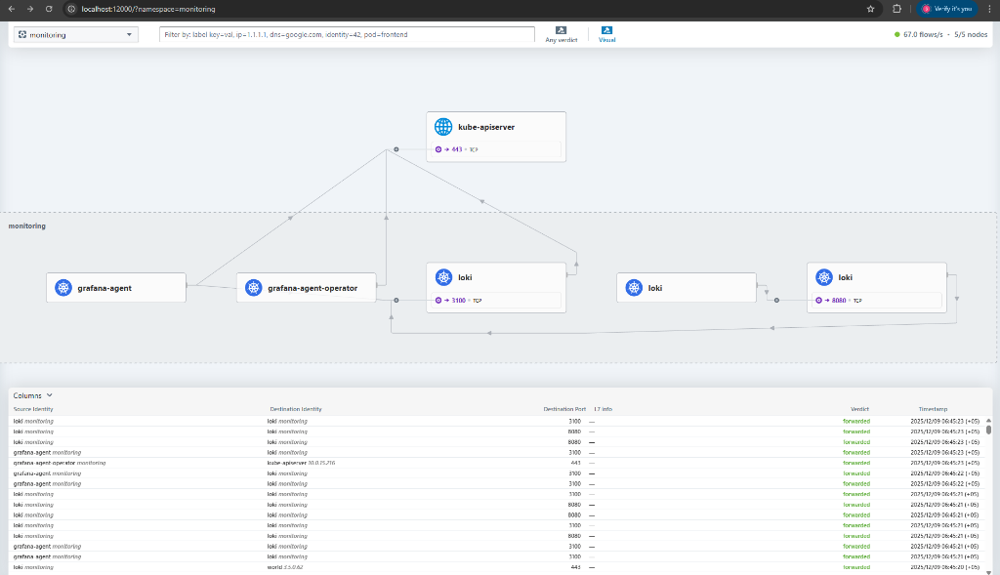

# High-Performance EKS Networking with Cilium eBPF

This repository documents the architectural migration of a production-grade Amazon EKS cluster from the standard legacy networking stack (AWS VPC CNI + Kube-Proxy) to a high-performance, kernel-bypass architecture using **Cilium eBPF**.


*Figure 1: Real-time L7 traffic visualization via Hubble Service Map.*

---

## 🛑 The Challenge: Limitations of Legacy Networking
Our initial EKS architecture relied on the default AWS networking stack, which introduced significant bottlenecks at scale:
1.  **Latency Overhead**: `kube-proxy` relies on IPTables, which has O(N) lookup complexity. As services scaled to thousands of IP rules, packet processing latency increased.
2.  **Observability Blind Spots**: AWS VPC Flow Logs only provide 5-tuple data (IP/Port). We had zero visibility into HTTP/DNS failures or Layer 7 protocol errors.
3.  **Security Gaps**: Kubernetes NetworkPolicies are IP-based, making it difficult to secure dynamic workloads without complex CIDR management.

## ⚡ The Solution: Cilium eBPF (Native Routing Mode)
We replaced the datapath with **Cilium**, leveraging eBPF (Extended Berkeley Packet Filter) for highly efficient, programmable packet processing in the Linux kernel.

### Architecture Highlights
*   **eBPF Datapath (`kubeProxyReplacement=true`)**: Completely removes IPTables usage for service load balancing, achieving near-native network performance (O(1) complexity).
*   **AWS ENI IPAM (`ipam: eni`)**: Maintains direct pod-to-VPC routing. Pods receive direct AWS VPC IPs, ensuring compatibility with existing AWS security groups and routing tables.
*   **Layer 7 Visibility**: Enabled **Hubble**, providing deep insight into application protocols (HTTP, gRPC, DNS) and "Why is this packet dropping?" verdicts.

---

## 🔧 Critical Challenges & Solutions

### 1. The "Tunnel Mode" vs. "Native Routing" Conflict
This was the most complex technical hurdle during the migration.

*   **The Issue**: After deploying the Helm chart with `ipam: eni` enabled, the Cilium agents failed to start, entering a `CrashLoopBackOff` state.
*   **The Error**: `Cannot specify IPAM mode eni in tunnel mode`.
*   **Root Cause**: AWS ENI mode requires direct routing (Native Layer 3) between pods. However, the Helm chart default configuration implicitly enabled `tunnel: vxlan` encapsulation, which fundamentally conflicts with the direct-routing requirement of AWS ENIs.
*   **The Fix**:
    We had to explicitly patch the configurations to disable tunneling and enforce native routing.
    *   **Terraform Fix**: Updated `values.yaml` to include `tunnel: disabled` and `routingMode: native`.
    *   **Live Patching**: During the blackout window, we executed a JSON patch on the `cilium-config` ConfigMap to forcibly remove the `tunnel-protocol` key, restoring service connectivity immediately.

### 2. The Network Blackout (Clean Teardown)
Cilium and `aws-node` cannot coexist on the same interface. We built a migration script to orchestrate the "Network Blackout":
1.  **Drain**: Cordoned nodes to prevent new scheduling.
2.  **Purge**: Force deleted `aws-node` and `kube-proxy` DaemonSets.
3.  **Inject**: Installed Cilium CNI.
4.  **Restore**: Recycled all pods to bind them to the new BPF maps.

---

## 📂 Repository Structure

| Directory | Description |
| :--- | :--- |
| `/infrastructure` | Terraform code defining the migration logic (`helm_release` + `null_resource`). |
| `/helm-config` | Production `values.yaml` used for the Cilium chart (ENI mode + Hubble enabled). |
| `/migration-scripts` | PowerShell automation for cleaning up legacy DaemonSets. |
| `/policies` | Example CiliumNetworkPolicies showcasing Layer 7 (HTTP) security rules. |
| `/evidence` | Proof of Work: Screenshots of the Hubble Observability Dashboard. |

---

## 🚀 How to Replicate

1.  **Clone the Repo**:
    ```bash
    git clone https://github.com/sikanderhameed/eks-cilium-network-modernization.git
    cd eks-cilium-network-modernization
    ```

2.  **Apply Terraform**:
    Navigate to `/infrastructure` and run:
    ```bash
    terraform init
    terraform apply
    ```

3.  **Verify Status**:
    ```bash
    cilium status --wait
    kubectl get pods -n kube-system
    ```

4.  **Access Hubble**:
    ```bash
    cilium hubble ui
    ```

